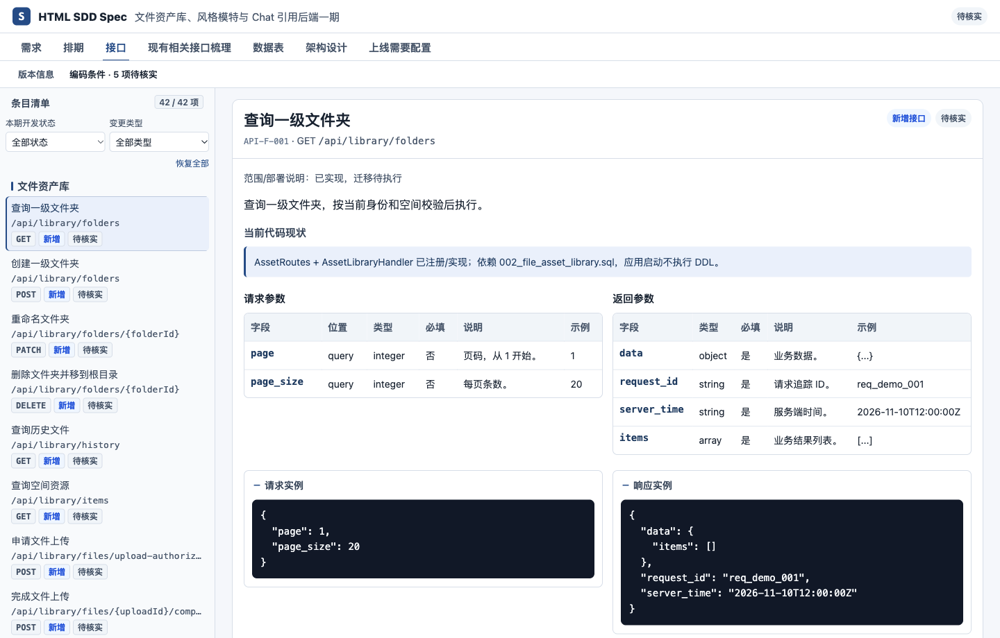
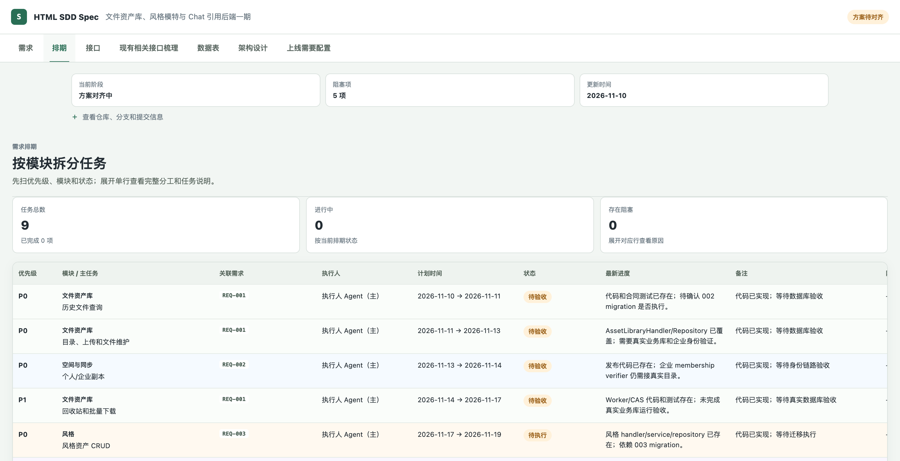
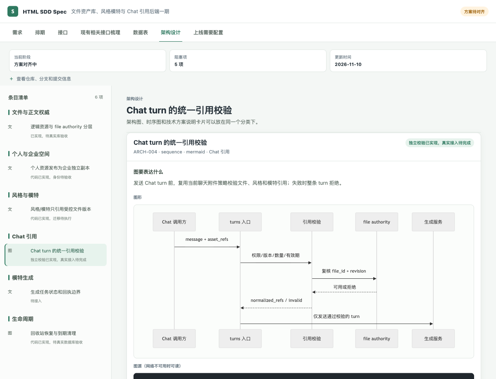

# HTML SDD Spec

[中文](README.md) · [Quick-start example](examples/订单状态筛选/使用说明.md) · [Asset library example](examples/asset-library/README.md) · [Setup guide](docs/安装使用.md) · [Downloads](https://github.com/maimai-git/html-sdd-spec/releases/latest)

Bring a requirement's **goals, current implementation, design, and progress** together in a shareable HTML page. Product managers, developers, and reviewers can see what needs to change, who owns the work, and how to verify it.

## Features

| Area | What you can see |
| --- | --- |
| Requirements and acceptance | Goals, scope, existing behavior, open questions, and acceptance criteria |
| Schedule | Tasks by module, priority, assignee, status, and progress. Filter, sort, and expand each task for details. |
| APIs and data tables | New and changed APIs and tables, request and response examples, and database change SQL |
| Architecture and rollout | Design notes by module, architecture and sequence diagrams, and rollout configuration |
| Changes and AI collaboration | Compare revisions and retrieve the context for a specific requirement or task. Work with one agent or split the work across agents. |

## Screenshots







## Quick start

**View the example.** Download the repository and open the local `examples/asset-library/index.html` file in your browser. No preview server is needed. The page loads Vue from a CDN.

**Use Codex.** Install the CLI and Skill using the setup guide, then ask Codex to work on a requirement in your project. [Setup guide](docs/安装使用.md#4-作为-codex-skill-使用)

> Use HTML SDD to plan batch shipping. Review the current code and document the affected APIs, tables, schedule, and acceptance criteria for review.

**Use the CLI.** With Python 3.9 or later, run these commands in your project:

```bash
python -m pip install "https://github.com/maimai-git/html-sdd-spec/releases/download/v0.6.0/html_sdd_spec-0.6.0-py3-none-any.whl"
html-sdd init html-sdd-spec/batch-shipping
```

`init` creates `方案事实源.json` (the editable spec) and `方案对齐.html` (the generated page). Update the JSON yourself or with an agent, then check it and regenerate the page:

```bash
cd html-sdd-spec/batch-shipping
html-sdd check 方案事实源.json
html-sdd render 方案事实源.json --output 方案对齐.html
```

[Specification](SPEC.md) · [Changelog](CHANGELOG.md) · [Contributing](CONTRIBUTING.md) · [MIT License](LICENSE)
