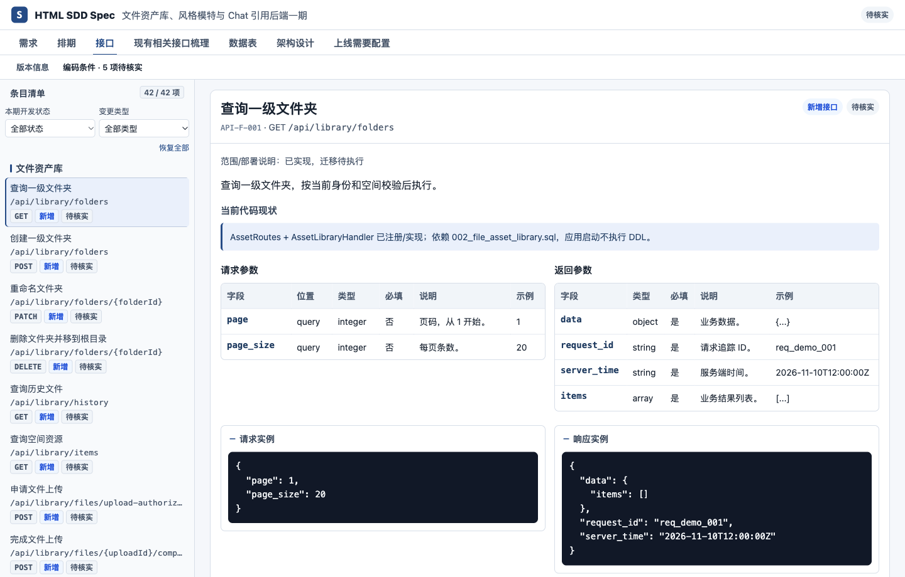
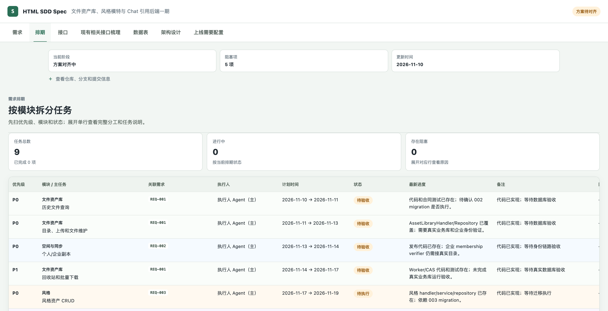
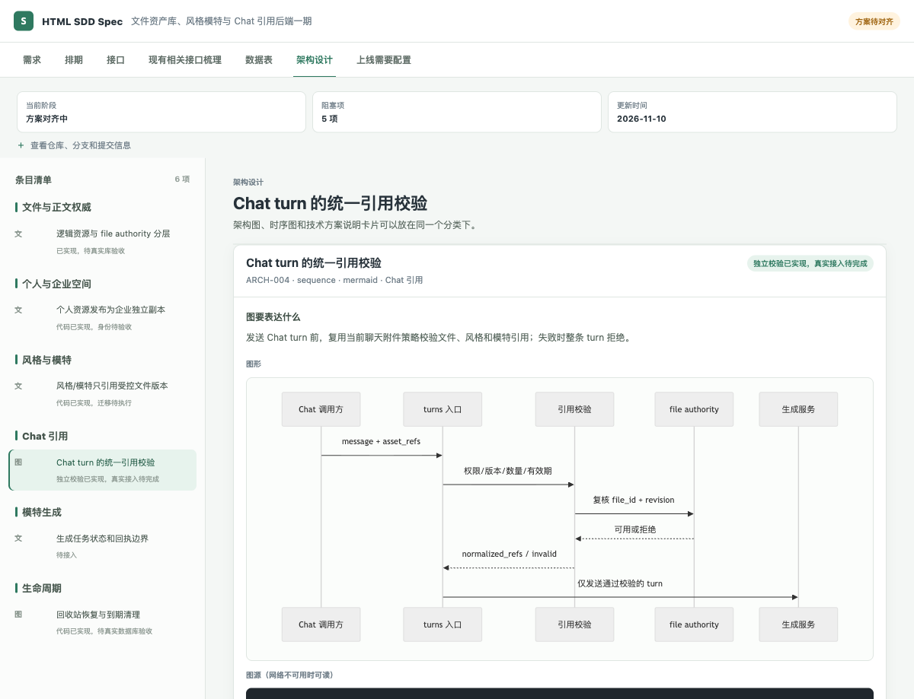

# HTML SDD Spec

[English](README.en.md) · [快速上手示例](examples/订单状态筛选/使用说明.md) · [资产库示例](examples/asset-library/README.md) · [安装与使用](docs/安装使用.md) · [版本下载](https://github.com/maimai-git/html-sdd-spec/releases/latest)

把一次需求的**目标、现状、方案和进度**放进一份可分享的 HTML。产品、开发和审核人员打开同一个页面，就能看到要做什么、改哪些地方、由谁完成，以及怎么验收。

## 有哪些功能

| 功能 | 可以看到什么 |
| --- | --- |
| 需求与验收 | 本次目标、范围、已有实现、待确认事项和验收标准 |
| 任务排期 | 模块、优先级、执行人、状态和进展，支持筛选和排序，点击任务展开详情 |
| 接口与数据表 | 新增或改动的接口和表，请求与响应示例、建表和变更 SQL |
| 架构与上线配置 | 按模块查看技术方案、架构图、时序图和上线需要配置的项目 |
| 变更与 AI 协作 | 比较两版方案，按需求或任务读取相关内容，支持单 Agent 或多人分工 |

## 示例截图







## 怎么用

**先看效果。** 下载仓库后，用浏览器直接打开本地文件 `examples/asset-library/index.html`，无需预览服务。页面使用 Vue CDN，需要联网。

**交给 Codex。** 按指南安装 CLI 和 Skill，然后在你的项目里直接说下面这句话。[安装指南](docs/安装使用.md#4-作为-codex-skill-使用)

> 用 HTML SDD 梳理批量发货需求。结合当前代码，列出涉及的接口、表、排期和验收标准，先对齐方案。

**用命令行。** 需要 Python 3.9 或更高版本。在项目目录里执行：

```bash
python -m pip install "https://github.com/maimai-git/html-sdd-spec/releases/download/v0.6.0/html_sdd_spec-0.6.0-py3-none-any.whl"
html-sdd init html-sdd-spec/批量发货
```

`init` 会生成 `方案事实源.json` 和 `方案对齐.html`。由你或 AI 更新 JSON，再检查并重新生成页面：

```bash
cd html-sdd-spec/批量发货
html-sdd check 方案事实源.json
html-sdd render 方案事实源.json --output 方案对齐.html
```

[完整规范](SPEC.md) · [更新记录](CHANGELOG.md) · [贡献指南](CONTRIBUTING.md) · [MIT 许可证](LICENSE)
